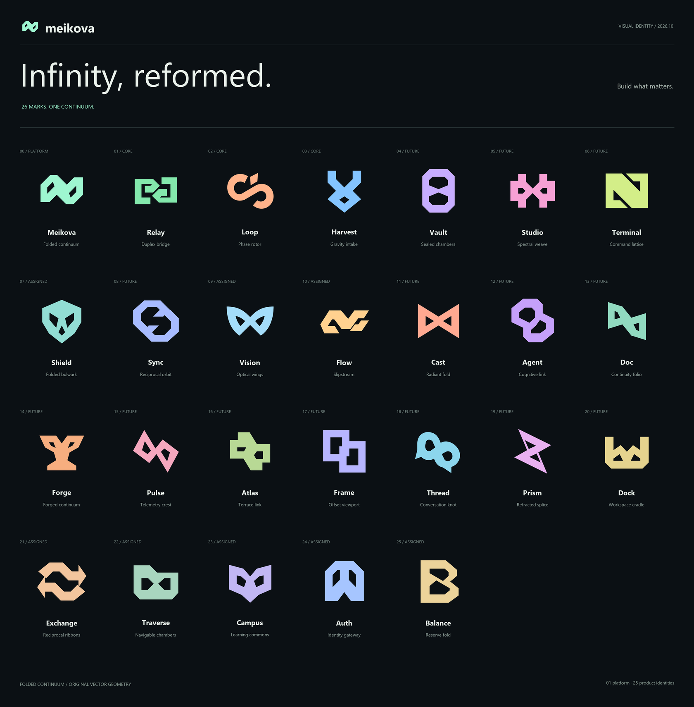

# MEIKOVA

**Build what matters.**  
*Hệ sinh thái phần mềm mã nguồn mở đa nền tảng, kiến trúc Ambient Dark và trải nghiệm Offline-First.*

  
  
  
  
  

---

## Triết Lý Phát Triển & Sứ Mệnh Cộng Đồng

Meikova được xây dựng với mục tiêu cung cấp bộ giải pháp phần mềm độc lập, mã nguồn mở, bảo vệ quyền riêng tư và phục vụ công việc hàng ngày của người dùng trên mọi nền tảng:

- **Mã nguồn mở vì cộng đồng:** 100% mã nguồn minh bạch, giấy phép MIT, không gắn mã theo dõi (zero analytics/telemetry), tự do tự lưu trữ (self-hostable) và làm chủ dữ liệu cá nhân.
- **Tiện ích thực chiến hàng ngày:** Tối ưu cho nhu cầu thực tế: hòa trộn âm thanh, thu nhận nội dung đa phương tiện, quản lý tài chính, truy cập máy tính từ xa, duyệt tệp tin bảo mật và giám sát an ninh mạng.
- **Đa nền tảng thống nhất:** Trải nghiệm liền mạch trên Windows, macOS, Linux, Android, iOS, Web PWA, Browser Extension và OS Background Services.
- **Offline-First & Hiệu năng cao:** Dữ liệu luôn lưu trữ cục bộ (Local SQLite WAL / Turso LibSQL Cloud Sync), khởi động dưới 1 giây, độ trễ tiệm cận 0ms và không phụ thuộc kết nối Internet liên tục.

---

## Bảng Nhận Diện 26 Thương Hiệu (Folded Continuum)

Toàn bộ hệ thống sản phẩm thuộc Meikova được chuẩn hóa dựa trên ngôn ngữ hình học **Folded Continuum** – nguyên lý hai thùy và giao điểm lemniscate không lặp lại:

  

---

## 4 Trụ Cột Nền Tảng Cốt Lõi (Core Ecosystem)

Bốn giải pháp nền tảng định hình khung kiến trúc phân tán của hệ sinh thái Meikova:

<table>
  <thead>
    <tr>
      <th width="70" align="center">Icon</th>
      <th width="200">Dự Án</th>
      <th>Mô Tả & Trọng Tâm Kỹ Thuật</th>
      <th width="140">Nền Tảng</th>
      <th width="110" align="center">Trạng Thái</th>
    </tr>
  </thead>
  <tbody>
    <tr>
      <td align="center">
        
      </td>
      <td>
        <a href="https://github.com/Meikova/meikova-auth"><strong>Meikova Auth</strong></a> 
        <code>meikova-auth</code>
      </td>
      <td>
        <strong>Identity Gateway & Universal SSO Gateway.</strong> 
        Cổng xác thực tập trung, xác minh Ed25519 offline (~0.1ms), PBKDF2/scrypt, Google OAuth 2.0 GIS đa nền tảng, tích hợp Turso LibSQL Cloud.
      </td>
      <td>Web SSO, Cloud REST, JWKS</td>
      <td align="center"></td>
    </tr>
    <tr>
      <td align="center">
        
      </td>
      <td>
        <a href="https://github.com/Meikova/meikova-relay"><strong>Meikova Relay</strong></a> 
        <code>meikova-relay</code>
      </td>
      <td>
        <strong>Duplex Bridge Remote Control.</strong> 
        Hệ thống điều khiển máy trạm từ xa và đường hầm đo xa (telemetry tunnel) độ trễ siêu thấp. Khách truy cập web client zero-install, truyền tải dữ liệu an toàn qua WebSocket.
      </td>
      <td>Desktop (Win/Linux/macOS), Web PWA</td>
      <td align="center"></td>
    </tr>
    <tr>
      <td align="center">
        
      </td>
      <td>
        <a href="https://github.com/Meikova/meikova-loop"><strong>Meikova Loop</strong></a> 
        <code>meikova-loop</code>
      </td>
      <td>
        <strong>Phase Rotor AI Audio Mashup Deck.</strong> 
        Bộ máy mashup âm thanh thời gian thực, tách stem Demucs (Vocals/Drums/Bass/Other), bộ lọc DSP, Web Audio API Canvas Visualizer và soundscape player liên tục.
      </td>
      <td>Web PWA, Desktop, Mobile, HF Space</td>
      <td align="center"></td>
    </tr>
    <tr>
      <td align="center">
        
      </td>
      <td>
        <a href="https://github.com/Meikova/meikova-harvest"><strong>Meikova Harvest</strong></a> 
        <code>meikova-harvest</code>
      </td>
      <td>
        <strong>Gravity Intake Media Engine.</strong> 
        Công cụ thu nhận và trích xuất đa phương tiện hiệu năng cao. Hỗ trợ đa luồng tải, chuyển đổi FFmpeg, stream capture, bypass kiểm duyệt qua Google DoH.
      </td>
      <td>Desktop Shell, Web, Chrome Extension</td>
      <td align="center"></td>
    </tr>
  </tbody>
</table>

---

## Dự Án Ứng Dụng Đang Phát Triển (Domain Extensions)

Các công cụ ứng dụng tiện ích chuyên sâu phục vụ đời sống, công việc kỹ thuật và quản lý dữ liệu:

<table>
  <thead>
    <tr>
      <th width="70" align="center">Icon</th>
      <th width="200">Dự Án</th>
      <th>Đặc Tả Nghiệp Vụ & Nền Tảng Kỹ Thuật</th>
      <th width="140">Stack Chính</th>
      <th width="110" align="center">Trạng Thái</th>
    </tr>
  </thead>
  <tbody>
    <tr>
      <td align="center">
        
      </td>
      <td>
        <a href="https://github.com/Meikova/meikova-balance"><strong>Meikova Balance</strong></a> 
        <code>meikova-balance</code>
      </td>
      <td>
        <strong>Reserve Fold Personal Finance.</strong> 
        Quản lý tài chính cá nhân thông minh, phân tích thu chi đa tiền tệ, bóc tách hóa đơn tự động qua AI cục bộ, theo dõi danh mục tài sản và dự toán ngân sách.
      </td>
      <td>TypeScript, SQLite, Local AI, PWA</td>
      <td align="center"></td>
    </tr>
    <tr>
      <td align="center">
        
      </td>
      <td>
        <a href="https://github.com/Meikova/meikova-vision"><strong>Meikova Vision</strong></a> 
        <code>meikova-vision</code>
      </td>
      <td>
        <strong>Optical Wings RAW & HDR Imaging.</strong> 
        Bộ xử lý ảnh chất lượng cao chuyên biệt cho file RAW, ghép phơi sáng đa khung (bracket merging), tone mapping thời gian thực và khử nhiễu ảnh số.
      </td>
      <td>Python, OpenCV, WebAssembly</td>
      <td align="center"></td>
    </tr>
    <tr>
      <td align="center">
        
      </td>
      <td>
        <a href="https://github.com/Meikova/meikova-flow"><strong>Meikova Flow</strong></a> 
        <code>meikova-flow</code>
      </td>
      <td>
        <strong>Slipstream ETL & Data Pipeline.</strong> 
        Bộ máy xử lý, chuyển đổi và tích hợp dữ liệu tốc độ cao. Tự động hóa đồng bộ CSDL phân tán, lập lịch biểu ETL và xuất báo cáo phân tích tự động.
      </td>
      <td>Python, Pandas, SQLite, Worker Pool</td>
      <td align="center"></td>
    </tr>
    <tr>
      <td align="center">
        
      </td>
      <td>
        <a href="https://github.com/Meikova/meikova-exchange"><strong>Meikova Exchange</strong></a> 
        <code>meikova-exchange</code>
      </td>
      <td>
        <strong>Reciprocal Ribbons B2B Marketplace.</strong> 
        Sàn giao dịch tài sản kỹ thuật số, dự án mã nguồn và giải pháp phần mềm doanh nghiệp với kiến trúc microservices và thanh toán ký quỹ (escrow).
      </td>
      <td>Node.js, TypeScript, Docker</td>
      <td align="center"></td>
    </tr>
    <tr>
      <td align="center">
        
      </td>
      <td>
        <a href="https://github.com/Meikova/meikova-shield"><strong>Meikova Shield</strong></a> 
        <code>meikova-shield</code>
      </td>
      <td>
        <strong>Folded Bulwark Threat Sentinel.</strong> 
        Hệ thống giám sát an ninh mạng, phát hiện nguy cơ web defacement và phân tích dấu hiệu tấn công thông qua mô hình học máy lai (hybrid ML).
      </td>
      <td>Python, Browser Shield, Threat Intel</td>
      <td align="center"></td>
    </tr>
    <tr>
      <td align="center">
        
      </td>
      <td>
        <a href="https://github.com/Meikova/meikova-campus"><strong>Meikova Campus</strong></a> 
        <code>meikova-campus</code>
      </td>
      <td>
        <strong>Learning Commons & Course Hub.</strong> 
        Nền tảng thương mại khóa học trực tuyến, hệ thống quản trị đào tạo (LMS), diễn đàn cộng đồng học viên và tích hợp lưu trữ đám mây.
      </td>
      <td>TypeScript, Express, Cloud Storage</td>
      <td align="center"></td>
    </tr>
    <tr>
      <td align="center">
        
      </td>
      <td>
        <a href="https://github.com/Meikova/meikova-traverse"><strong>Meikova Traverse</strong></a> 
        <code>meikova-traverse</code>
      </td>
      <td>
        <strong>Navigable Chambers File Explorer.</strong> 
        Trình duyệt và quản lý tệp tin đa nền tảng (Web & Desktop). Tích hợp giao thức SFTP, WebDAV, xem trước tập tin media và giải nén trực tuyến.
      </td>
      <td>TypeScript, Electron, Native FS</td>
      <td align="center"></td>
    </tr>
  </tbody>
</table>

---

## Lộ Trình Phát Triển Tương Lai (Upcoming Roadmap)

Bộ giải pháp quy hoạch theo 4 phân hệ chức năng chiến lược:

<table width="100%">
  <thead>
    <tr>
      <th width="25%">Bảo Mật & Trí Tuệ</th>
      <th width="25%">Sáng Tạo Đa Phương Tiện</th>
      <th width="25%">Hạ Tầng & Hệ Thống</th>
      <th width="25%">Cộng Tác & Quản Trị</th>
    </tr>
  </thead>
  <tbody>
    <tr valign="top">
      <td>
        

           <strong>Agent</strong> 
          Trợ lý AI tự trị hoạt động 100% cục bộ (Local LLM), điều phối quy trình an toàn không gửi dữ liệu ra ngoài.
        

        

           <strong>Vault</strong> 
          Kho lưu trữ mã hóa dữ liệu bảo mật cấp độ quân sự, quản trị mật khẩu cá nhân Zero-Knowledge.
        

      </td>
      <td>
        

           <strong>Studio</strong> 
          Biên tập âm thanh đa kênh chuyên nghiệp (DAW nhẹ), master track và thiết kế âm thanh không gian.
        

        

           <strong>Prism</strong> 
          Cắt dựng và xử lý video tăng tốc phần cứng GPU, tối ưu biên tập và chuyển mã hàng loạt.
        

        

           <strong>Cast</strong> 
          Truyền phát màn hình không dây, chia sẻ phiên làm việc trực tiếp thời gian thực WebRTC.
        

      </td>
      <td>
        

           <strong>Terminal</strong> 
          Mô phỏng terminal hiện đại, quản lý kết nối SSH đa máy chủ và điều phối cụm phân tán.
        

        

           <strong>Pulse</strong> 
          Bảng đo xa telemetry hệ thống, đo lường độ trễ mạng và cảnh báo bất thường thời gian thực.
        

        

           <strong>Sync</strong> 
          Tiện ích đồng bộ dữ liệu ngang hàng (P2P), chia sẻ clipboard và truyền tập tin tốc độ mạng LAN.
        

      </td>
      <td>
        

           <strong>Doc</strong> 
          Không gian ghi chép và quản trị tri thức dạng đồ thị, hỗ trợ định dạng Markdown mở cục bộ.
        

        

           <strong>Thread</strong> 
          Hội thoại nhóm nội bộ và cộng tác phân tán với mã hóa đầu-cuối (E2EE) không qua máy chủ đám mây.
        

        

           <strong>Atlas</strong> 
          Công cụ hoạch định tiến độ phát triển dự án, theo dõi roadmap kỹ thuật và backlog liên repo.
        

        

           <strong>Dock</strong> 
          Khay điều hướng ứng dụng và launcher tập trung, tích hợp phím tắt toàn cục và quản lý cửa sổ.
        

        

           <strong>Forge</strong> 
          Bộ công cụ tự động hóa đóng gói đa nền tảng (Win/Mac/Linux/Android), ký số binary và xuất bản CI/CD.
        

      </td>
    </tr>
  </tbody>
</table>

### Chi Tiết Danh Mục Quy Hoạch:

<table>
  <thead>
    <tr>
      <th width="70" align="center">Icon</th>
      <th width="180">Tên Dự Kiến</th>
      <th>Định Hướng Chức Năng</th>
      <th width="140">Mã Nhận Diện</th>
    </tr>
  </thead>
  <tbody>
    <tr>
      <td align="center"></td>
      <td><strong>Meikova Agent</strong></td>
      <td>Trợ lý AI tự trị hoạt động 100% cục bộ (Local LLM), điều phối tác vụ và tự động hóa quy trình không gửi dữ liệu ra ngoài.</td>
      <td><code>#C5A0FA</code> Cognitive link</td>
    </tr>
    <tr>
      <td align="center"></td>
      <td><strong>Meikova Vault</strong></td>
      <td>Kho lưu trữ dữ liệu mã hóa cấp độ quân sự, quản lý mật khẩu và chứng thư số cá nhân với kiến trúc Zero-Knowledge.</td>
      <td><code>#C7ADFF</code> Sealed chambers</td>
    </tr>
    <tr>
      <td align="center"></td>
      <td><strong>Meikova Studio</strong></td>
      <td>Phần mềm biên tập âm thanh đa kênh chuyên nghiệp (DAW nhẹ), master track và thiết kế âm thanh không gian.</td>
      <td><code>#F6A0D4</code> Spectral weave</td>
    </tr>
    <tr>
      <td align="center"></td>
      <td><strong>Meikova Prism</strong></td>
      <td>Phần mềm cắt dựng và biên tập video tăng tốc phần cứng GPU, tối ưu xuất bản nội dung nhanh và chuyển mã hàng loạt.</td>
      <td><code>#E9B0F1</code> Refracted splice</td>
    </tr>
    <tr>
      <td align="center"></td>
      <td><strong>Meikova Cast</strong></td>
      <td>Công cụ truyền phát màn hình, trình chiếu không dây và chia sẻ phiên làm việc trực tiếp thời gian thực qua WebRTC.</td>
      <td><code>#FFA991</code> Radiant fold</td>
    </tr>
    <tr>
      <td align="center"></td>
      <td><strong>Meikova Terminal</strong></td>
      <td>Trình mô phỏng terminal hiện đại, quản lý kết nối SSH đa máy chủ, điều phối container và giám sát cụm phân tán.</td>
      <td><code>#D3EE88</code> Command lattice</td>
    </tr>
    <tr>
      <td align="center"></td>
      <td><strong>Meikova Pulse</strong></td>
      <td>Bảng điều khiển giám sát sức khỏe hệ thống, đo lường độ trễ mạng, mức sử dụng tài nguyên và gửi cảnh báo thời gian thực.</td>
      <td><code>#F5A7BE</code> Telemetry crest</td>
    </tr>
    <tr>
      <td align="center"></td>
      <td><strong>Meikova Sync</strong></td>
      <td>Tiện ích đồng bộ dữ liệu ngang hàng (P2P), truyền tập tin tốc độ LAN/Mesh và đồng bộ clipboard giữa máy tính và điện thoại.</td>
      <td><code>#A7BBFF</code> Reciprocal orbit</td>
    </tr>
    <tr>
      <td align="center"></td>
      <td><strong>Meikova Doc</strong></td>
      <td>Không gian ghi chép và quản trị tri thức dạng đồ thị, hỗ trợ định dạng Markdown mở và lưu trữ cục bộ vĩnh viễn.</td>
      <td><code>#91DAC0</code> Continuity folio</td>
    </tr>
    <tr>
      <td align="center"></td>
      <td><strong>Meikova Thread</strong></td>
      <td>Ứng dụng trò chuyện nhóm và cộng tác nội bộ với mã hóa đầu-cuối (E2EE), loại bỏ trung gian máy chủ đám mây.</td>
      <td><code>#8CD6ED</code> Conversation knot</td>
    </tr>
    <tr>
      <td align="center"></td>
      <td><strong>Meikova Atlas</strong></td>
      <td>Công cụ lập kế hoạch phát triển dự án, theo dõi roadmap kỹ thuật, quản lý backlog và liên kết chéo các repository.</td>
      <td><code>#B8D995</code> Terrace link</td>
    </tr>
    <tr>
      <td align="center"></td>
      <td><strong>Meikova Dock</strong></td>
      <td>Khay điều hướng ứng dụng và bố trí không gian làm việc tập trung, tích hợp phím tắt toàn cục và quản lý cửa sổ thông minh.</td>
      <td><code>#E5D38E</code> Workspace cradle</td>
    </tr>
    <tr>
      <td align="center"></td>
      <td><strong>Meikova Forge</strong></td>
      <td>Bộ công cụ tự động hóa đóng gói ứng dụng đa nền tảng (Win/Mac/Linux/Android), ký số binary và xuất bản phát hành CI/CD.</td>
      <td><code>#F7AE7F</code> Forged continuum</td>
    </tr>
  </tbody>
</table>

---

## Chuẩn Mực Thiết Kế: Ambient Instrument

Toàn bộ ứng dụng trong hệ sinh thái tuân thủ nghiêm ngặt ngôn ngữ thiết kế **Ambient Instrument**:

- **Không gian màu OKLCH:** Chuyển đổi ánh sáng mượt mà với CSS `@property`, thích ứng độ tương phản chuẩn xác cho chế độ nền tối (Dark-first).
- **Hệ thống phông chữ 3 tầng:**
  - Tiêu đề & Nhận diện: **Unbounded**
  - Giao diện & Thao tác: **Be Vietnam Pro** (tối ưu 100% dấu thanh tiếng Việt)
  - Số liệu & Đo xa kỹ thuật: **JetBrains Mono**
- **100% Vector SVG:** Không dùng font icon bên ngoài; mọi biểu tượng là vector nội tuyến có tâm quang học chuẩn xác.
- **Tối giản phụ thuộc:** Ưu tiên mã nguồn JavaScript thuần (Vanilla JS / ES Modules), loại bỏ framework cồng kềnh, tối đa tốc độ kết xuất và tiết kiệm RAM/CPU.

---

## Đóng Góp & Hợp Tác

Hệ sinh thái Meikova hoan nghênh mọi đóng góp từ cộng đồng:
- Báo cáo lỗi kỹ thuật & Đề xuất tính năng mới qua **Issues** tại từng repository.
- Tham gia thảo luận kiến trúc tại **Discussions**.
- Tuân thủ quy chuẩn bảo vệ quyền riêng tư, an toàn dữ liệu và kiến trúc Offline-First khi gửi **Pull Request**.

---

© 2026 Meikova Ecosystem. Giấy phép mã nguồn mở MIT. Phát triển vì một môi trường phần mềm tự do, riêng tư và bền vững.

